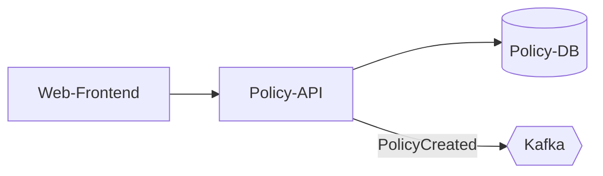

# arc42-Template: Kapitel und Leitfragen

Referenz zum Skill `arc42-docs`. Pro Kapitel: Zweck, Leitfragen und typische Inhalte. Basis ist arc42 in der aktuellen Version (siehe https://arc42.org).

## 1. Einführung und Ziele

**Zweck:** Warum gibt es das System, und was muss es leisten?

- Aufgabenstellung: Welche fachlichen Kernaufgaben erfüllt das System (3 bis 7 Punkte)?
- Qualitätsziele: Die drei bis fünf wichtigsten Qualitätsziele, priorisiert (z. B. Verfügbarkeit, Sicherheit, Änderbarkeit).
- Stakeholder: Tabelle mit Rolle, Kontakt und Erwartungshaltung an die Architektur.

## 2. Randbedingungen

**Zweck:** Was schränkt die Freiheit beim Entwurf ein?

- Technische Randbedingungen: vorgegebene Plattformen, Sprachen, Frameworks, Betriebsumgebung.
- Organisatorische Randbedingungen: Teamstruktur, Budget, Termine, Vorgaben der Konzernarchitektur.
- Konventionen: Coding-Guidelines, Namenskonventionen, Dokumentationsrichtlinien.
- Regulatorische Vorgaben: Datenschutz (DSG), Aufsichtsrecht, interne Security-Weisungen.

## 3. Kontextabgrenzung

**Zweck:** Wo hört das System auf, mit wem kommuniziert es?

- Fachlicher Kontext: Nutzende und Nachbarsysteme mit den fachlichen Daten, die ausgetauscht werden.
- Technischer Kontext: Kanäle und Protokolle (REST, gRPC, Kafka-Topics, SFTP, Datenbank-Links).
- Tabelle: Nachbarsystem | Richtung | Schnittstelle | Datenformat | Verantwortliches Team.

## 4. Lösungsstrategie

**Zweck:** Die grundlegenden Entscheidungen in Kurzform.

- Technologieentscheidungen und ihre Begründung (mit Verweis auf ADRs).
- Architekturstil (z. B. Microservices, modularer Monolith, Event-driven).
- Zuordnung: Welches Qualitätsziel wird durch welchen Lösungsansatz erreicht?

## 5. Bausteinsicht

**Zweck:** Statische Zerlegung des Systems.

- Ebene 1: Whitebox des Gesamtsystems mit den Top-Level-Bausteinen.
- Ebene 2: Whitebox ausgewählter Bausteine, sofern für das Verständnis nötig.
- Pro Baustein (Blackbox-Beschreibung): Verantwortung, Schnittstellen, Ablageort im Code, Qualitätsmerkmale, offene Punkte.

Beispiel Mermaid:

## 6. Laufzeitsicht

**Zweck:** Wie arbeiten die Bausteine bei wichtigen Abläufen zusammen?

- Zwei bis fünf architekturrelevante Szenarien: zentrale Use Cases, kritische Schnittstellen, Fehler- und Ausnahmeverhalten, Start und Shutdown.
- Darstellung als Sequenzdiagramm mit kurzer Beschreibung der Schritte.

## 7. Verteilungssicht

**Zweck:** Auf welcher Infrastruktur läuft das System?

- Umgebungen (DEV, TEST, INT, PROD) und ihre Unterschiede.
- Zuordnung der Bausteine zu Laufzeitumgebungen (Kubernetes-Namespaces, VMs, Managed Services).
- Netzwerkzonen, Firewalls, externe Endpunkte.

## 8. Querschnittliche Konzepte

**Zweck:** Lösungen, die in mehreren Bausteinen gleich angewendet werden.

Typische Themen: Domänenmodell, Persistenz, Security (AuthN/AuthZ), Logging und Monitoring, Fehlerbehandlung, Transaktionen, Konfiguration, Testkonzept, Mandantenfähigkeit, Internationalisierung.

## 9. Architekturentscheidungen

**Zweck:** Übersicht über alle wichtigen Entscheidungen.

- Tabelle: Nr. | Titel | Status | Datum | Link zur ADR.
- Die Details stehen in den einzelnen ADR-Dateien unter `adr/`.

## 10. Qualitätsanforderungen

**Zweck:** Konkrete, überprüfbare Qualitätsanforderungen.

- Qualitätsbaum: Qualitätsmerkmale nach ISO 25010 mit Verfeinerung.
- Qualitätsszenarien mit den Elementen Quelle, Stimulus, Umgebung, Artefakt, Antwort, Antwortmass.

Beispiel: «Bei einem Ausfall eines Kafka-Brokers in PROD (Stimulus) verarbeitet der Policy-Service (Artefakt) weiterhin Events ohne Datenverlust (Antwort); die Verzögerung beträgt maximal 30 Sekunden (Antwortmass).»

## 11. Risiken und technische Schulden

**Zweck:** Bekannte Probleme transparent machen.

- Tabelle: Risiko oder Schuld | Auswirkung | Eintrittswahrscheinlichkeit | Massnahme | Verantwortlich.
- Regelmässig (z. B. pro PI) überprüfen.

## 12. Glossar

**Zweck:** Einheitliches Verständnis der Fach- und Tech-Begriffe.

- Tabelle: Begriff | Definition | Synonyme oder englische Entsprechung.
- Fachbegriffe aus der Versicherungsdomäne (z. B. Police, Leistungsfall, Prämie) mit präziser Definition.
